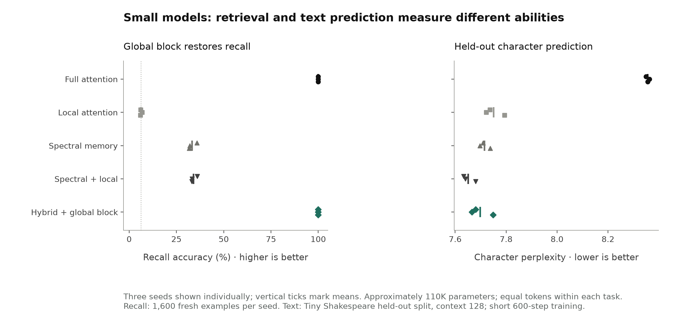
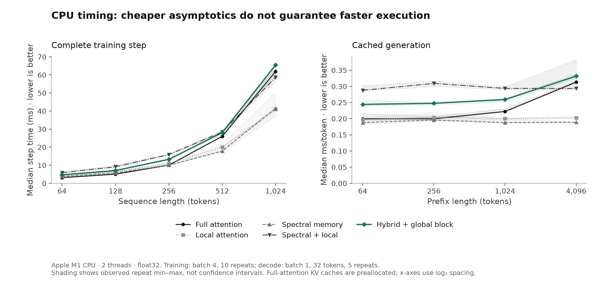

# First training and hardware results

## Decision within this experiment

Pure spectral variants learned short-context character prediction but failed key/value binding: their unique-value recall stayed near the 25% query-blind baseline. Increasing modes from eight to 32 did not fix the original retrieval task in the exploratory runs. Keeping one global-attention block restored 100% default recall and roughly halved retained decode-cache storage, but did not beat full attention on the measured training-step or per-token decode times. This is a useful memory tradeoff, not a demonstrated throughput win at matched retrieval quality.

The spectral operation is trainable and causal. The two-block striped model contains one spectral-plus-local block and one full-attention block; it retains quadratic attention in half its blocks. Its result does not show that the modal memory learned exact retrieval.

## From theoretical yield to execution

[THEORY.md](../THEORY.md) derives the causal FFT/recurrence equivalence, fixed-cache benefit, compute terms, and finite-state limitations. The global branch uses damped modes without hard low-pass truncation. Actual experiments use approximately 110K parameters, two blocks, width 64, eight modes, and a local window of eight. A causal previous-token stem is shared by every model.

The baseline without that stem did not learn binding at 3,000 steps. That pilot is retained in `pilot_without_stem/`. The shared stem then let the attention control solve the diagnostic in 1,000 steps. We fixed that common stem and 1,000-step budget before comparing the other variants. This is protocol development on a synthetic diagnostic, not a pre-registered benchmark.

## Prediction and retrieval

| Model | Parameters (text) | Recall (%) ↑ | Character perplexity ↓ |
| --- | ---: | ---: | ---: |
| Full attention | 112,640 | 100.0 ± 0.0 | 8.36 ± 0.01 |
| Local attention | 112,640 | 6.3 ± 0.5 | 7.75 ± 0.04 |
| Spectral memory | 112,416 | 33.2 ± 2.2 | 7.71 ± 0.02 |
| Spectral + local | 112,416 | 34.1 ± 1.6 | 7.65 ± 0.03 |
| Hybrid + global block | 112,528 | 100.0 ± 0.0 | 7.70 ± 0.04 |

Values are means ± sample standard deviation over seeds 0, 1, 2. These are seed spreads, not confidence intervals. Each model sees identical training data per seed: 1,536,000 input tokens for retrieval and 1,228,800 input tokens for text. The retrieval loss supervises one answer per example; the text loss supervises every next character. Parameter counts differ by less than 0.3%; the hybrid pays for its second mixer with a narrower feed-forward layer.

Relative mean character-perplexity changes versus full attention: Local attention -7.2%, Spectral memory -7.7%, Spectral + local -8.4%, Hybrid + global block -7.9%. These are short training runs on a single small corpus. The learning curves have not established convergence or scaling behavior. They cannot establish a general language-model advantage.

## Is recall actually query-dependent?

Uniform value guessing scores 6.25%. A query-blind oracle that knows the four stored values and guesses the most frequent one averages 33.7158% on the original task. Therefore roughly 34% original-task accuracy is not evidence of binding keys to values.

The stronger control uses four distinct stored values and asks all four keys for each fixed context. A query-blind prediction then scores exactly 25%. Each seed uses 512 contexts and 2,048 queries.

| Model | Unique-value recall (%) ↑ | Contexts where changing query changes prediction (%) |
| --- | ---: | ---: |
| Full attention | 100.0 | 100.0 |
| Local attention | 6.5 | 48.6 |
| Spectral memory | 24.9 | 47.9 |
| Spectral + local | 25.6 | 41.7 |
| Hybrid + global block | 100.0 | 100.0 |

Query-dependent predictions alone are insufficient: a wrong answer can also change. Interpret that column alongside answer accuracy. The unique-value condition is common under the original training distribution; it is not a wholly new key/value format.

## Follow the failed branch

The 32-mode branches are exploratory single-seed checks after observing weak eight-mode recall. They retain the same approximate parameter budget by reducing feed-forward width; this tests a parameter-allocation choice, not a pure capacity increase.

| Exploratory branch (seed 0 only) | Modes | Recall (%) |
| --- | ---: | ---: |
| Spectral + local | 32 | 33.9 |
| Spectral memory | 32 | 33.4 |

The striped fallback retains a direct global retrieval mechanism. Its observed success justifies testing reduced attention frequency; it does not show that the modal memory itself learned exact retrieval.

## Transfer beyond the trained configuration

All retrieval models train with four pairs and length 48. The following values are means over three seeds, using fresh generated mappings. They change pair count or context length without additional training.

| Model | 2 pairs, L=48 (%) | 8 pairs, L=48 (%) | 4 pairs, L=96 (%) | 4 pairs, L=192 (%) |
| --- | ---: | ---: | ---: | ---: |
| Full attention | 100.0 | 100.0 | 82.4 | 72.7 |
| Local attention | 5.6 | 6.3 | 6.2 | 6.6 |
| Spectral memory | 53.2 | 23.5 | 9.7 | 9.9 |
| Spectral + local | 52.9 | 23.4 | 7.9 | 8.9 |
| Hybrid + global block | 100.0 | 100.0 | 99.6 | 90.6 |

Length extrapolation and additional stored pairs are distinct stresses. A failure limits the result to the trained regime even if default accuracy is perfect. Fixed absolute record positions and sinusoidal positions are possible sources of length sensitivity.

## Measured CPU costs

| Model | Training step at L=1,024 (ms) ↓ | Decode at prefix 4,096 (ms/token) ↓ | Cache at prefix 4,096 (KiB) ↓ |
| --- | ---: | ---: | ---: |
| Full attention | 61.91 | 0.313 | 4128.25 |
| Local attention | 41.00 | 0.203 | 8.25 |
| Spectral memory | 41.46 | 0.189 | 8.25 |
| Spectral + local | 58.67 | 0.294 | 16.25 |
| Hybrid + global block | 65.44 | 0.332 | 2072.25 |

Training numbers include forward, loss, backward, clipping, and AdamW; spectral kernels are rebuilt as weights change. Ten measured steps follow three warmups. Decode numbers are medians of five repeated 32-token continuations after one warmup, with cached execution of the entire model. Prefix lengths are starting lengths; full attention grows by another 32 tokens during each continuation. Benchmarks are run sequentially after training, with no intentional competing experiment jobs. Random model weights are used for timing; these are architecture timings, not quality-matched deployment results.

Cache numbers count retained tensor payload, including complex modal states, unused reserved KV capacity and the common previous-token stem, but exclude weights, allocator overhead, attention workspaces and the runtime. Full-attention KV buffers are preallocated with 32 spare positions; none of the measured continuations reallocates or concatenates a growing global cache. Small local-window buffers still concatenate only their bounded window. These are Python/PyTorch reference paths rather than fused deployment kernels. Neither this implementation nor these Apple M1 CPU timings establish a GPU advantage.

Theoretical fixed-memory benefits are useful even if this FFT implementation is slower. They are different claims. A striped model still retains one growing global KV cache and an O(L²) training component.

## Checks and provenance

- All five model variants pass future-perturbation, prefix consistency, and future-gradient checks at float32 tolerances. Complete-forward and cached-generation logits agree on tested inputs. Trained retrieval checkpoints are also checked by `diagnose.py`.
- Spectral input gradients pass double-precision finite-difference checking; selected decay, frequency and residue derivatives are checked independently. This is a focused implementation check, not exhaustive numerical verification.
- Bounded local attention agrees with a dense masked reference. The bounded implementation does not materialize a full L×L attention score matrix.
- Host: {'torch': '2.15.0', 'python': '3.13.3', 'machine': 'arm64', 'device': 'cpu', 'dtype': 'float32', 'threads': 2, 'platform': 'macOS-15.5-arm64-arm-64bit-Mach-O'}. Timings are local measurements on this machine, with no extrapolation to accelerator hardware.
- Text source: [Tiny Shakespeare](https://raw.githubusercontent.com/karpathy/char-rnn/master/data/tinyshakespeare/input.txt); SHA-256 `86c4e6aa9db7c042ec79f339dcb96d42b0075e16b8fc2e86bf0ca57e2dc565ed`. First 1,003,854 characters train, final 111,540 validate. The 65-character inventory is built from the full file; no validation token sequence is used for training. Validation samples are repeated overlapping windows, so 102,400 scored next-character positions per seed are not 102,400 independent observations.
- `samples.txt` contains fixed-prompt character generation for illustration; it is not a quality metric. Raw curves, evaluation seeds, environment, final weights and per-run records are retained beside this report.

## Scope and next decision

This is a completed small-scale screening experiment. It tests causal trainability, short-budget text prediction, a controlled retrieval diagnostic, and CPU timing. It does not test useful-scale pretraining, GPU kernels, broad language understanding, long-context text quality, equal-quality large-model throughput, or convergence. The original 3% perplexity / 5 percentage-point recall / 20% utility thresholds cannot be interpreted as general acceptance from this corpus alone.

Use the retrieval controls to decide whether to keep the memory mechanism. If it remains at the query-blind baseline, the next meaningful branch is explicit content-addressable memory or selective state updates, rather than simply calling its global mixture “semantic context.” Keep the full-attention control and the successful striped fallback visible in any next experiment.

Two primary-source connections guide that next branch. [Structured state-space duality / Mamba-2](https://arxiv.org/abs/2405.21060) connects structured state-space operators and variants of attention through structured matrix representations. [Gated DeltaNet](https://arxiv.org/abs/2412.06464) combines adaptive forgetting with targeted associative-memory updates and tests retrieval. These papers motivate testing a queryable key/value state rather than adding more fixed temporal modes. They do not prove the cause of this prototype's failure or establish that a proposed modification will work. Input-dependent memory updates generally require a scan or chunked algorithm instead of this single stationary FFT convolution.

## Follow-up: text quality and long-prefix costs

The striped model was directly compared with full attention on a held-out Hamlet tail and on held-out tails from Hamlet, *Alice's Adventures in Wonderland*, and *Moby-Dick*, with equal 1,228,800-character training budgets and three seeds. It did not lose character-level predictive quality in these short runs; perplexity was lower on each test. At 8,192-character prefixes, the trained reference implementation used about half the cache and had lower measured prefill time, while token-by-token decode was approximately tied. At 512 characters it was slower to prefill and decode. These are small CPU character-model results, not evidence of a generally superior language model or GPU speedup. Full details, per-seed measurements, text provenance, and the reproduction command are in [TEXT_HEAD_TO_HEAD.md](TEXT_HEAD_TO_HEAD.md).

## Controlled audit follow-up

See [the rigorous study](../rigorous/REPORT.md) for the completed controls and limitations. The original character-level quality advantage survives equal-character comparisons, but calibrated training cost, stronger local baselines, and context extrapolation change the practical conclusion. The striped architecture still has a growing global KV cache and quadratic attention work in its remaining full-attention block.
